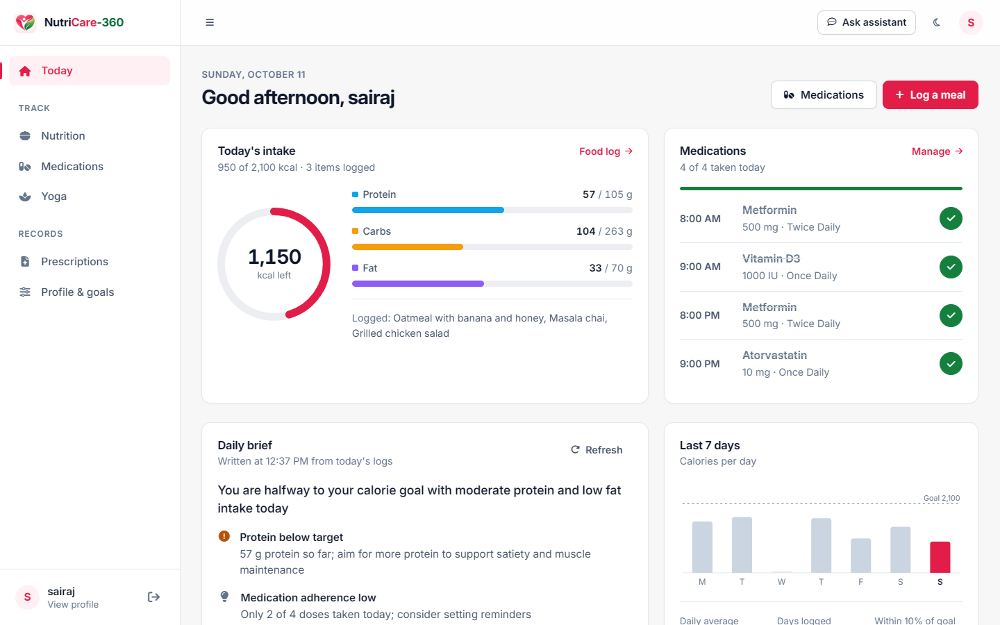

<p align="center">
  
</p>

# NutriCare-360

> A full-stack personal health app — meals, medications, prescriptions and yoga in one place, with an AI layer that works from your own logs.

[](https://react.dev)
[](https://flask.palletsprojects.com)
[](https://sqlite.org)
[](https://console.groq.com)

> **🔗 Quick Links**
> * 🚀 **[Live Demo](https://nutri-care-360.vercel.app/)**
> * 📖 **[Case Study](docs/CASE_STUDY.md)**
> * 📚 **[API Reference](docs/API.md)** · **[Swagger UI](https://nutri-care-360.vercel.app/apidocs)**



---

## What it does

| Area | Details |
|---|---|
| **Today dashboard** | Calorie ring and macro bars, a tick-off medication checklist, a 7-day calorie chart and an AI daily brief |
| **Meal logging** | Describe a meal in plain English → itemized calories, protein, carbs and fat; untick what you didn't eat and log the rest. Or search Open Food Facts |
| **Medications** | Reminders with dose, time and frequency, grouped into "still to take" and "taken today" |
| **Prescriptions** | Drag-and-drop upload of photos and PDFs |
| **Yoga** | 26-pose library; click any pose for a full guide (steps with breath cues, muscles, MET-based calorie estimate, mistakes, variations, cautions). An AI routine builder sequences poses for a goal and length, with a timer |
| **Assistant** | A chat drawer that answers questions about your own week, with safety rules on medication advice |
| **Health card** | One-click PNG summary of your week to share |

### AI features (Groq)

All AI calls go through one validated helper in the backend and degrade gracefully when no key is set.

| Feature | Endpoint | Notes |
|---|---|---|
| Meal analyzer | `POST /api/nutrition/analyze` | Itemized macros, assumed portions, one tip |
| Daily brief | `GET/POST /api/ai/insights` | Cached once per user per day; regenerated on demand |
| Assistant | `POST /api/ai/chat` | Grounded in the user's logs; never suggests dose changes |
| Routine builder | `POST /api/ai/yoga-routine` | Only uses poses that exist in the library |
| Pose guides | `GET /api/yoga/poses/<slug>/details` | Served from a reviewed JSON file; poses missing from it are generated once and cached |

---

## Tech stack

```
frontend/   React 19 · Vite · React Router 7 · Axios · hand-written CSS (Tailwind preflight only)
backend/    Python · Flask · SQLite · Flask-JWT-Extended · Flasgger (Swagger)
api/        Vercel serverless entry point (mirrors backend/app.py)
AI          Groq — openai/gpt-oss-120b by default (set GROQ_MODEL to change)
```

---

## Quick start

```bash
# 1. Backend
cd backend
cp .env.example .env        # set JWT_SECRET_KEY and GROQ_API_KEY
pip install -r requirements.txt
python app.py               # http://localhost:5000  ·  Swagger at /apidocs

# 2. Frontend (new terminal)
cd frontend
npm install
npm run dev                 # http://localhost:5173 (proxies /api to :5000)
```

To point the dev proxy at another backend port: `API_PROXY=http://localhost:5055 npm run dev`.

---

## Environment variables (`backend/.env`)

| Variable | Required | Description |
|---|---|---|
| `JWT_SECRET_KEY` | ✅ | Long random string for token signing |
| `GROQ_API_KEY` | Recommended | Enables every AI feature; without it they show a "not configured" state |
| `GROQ_MODEL` | Optional | Defaults to `openai/gpt-oss-120b` |
| `RAPIDAPI_KEY` | Optional | ExerciseDB pose source; falls back to `static/data/yoga.json` |

---

## Maintenance scripts

| Command | What it does |
|---|---|
| `python frontend/scripts/optimize_images.py` | Builds responsive WebP images, favicons, app icons and the share image from the originals in `frontend/image-sources/` |
| `python backend/generate_pose_details.py` | Writes AI pose guides into `backend/static/data/yoga_details.json` for any pose that has none (mirrored to `api/`). `--force <slug>` regenerates one |

**Adding a yoga pose:** add it to `backend/static/data/yoga.json` (and `api/static/data/`), drop its photo in `frontend/image-sources/` as `yoga-<slug>.png`, then run both scripts. Review the new entry in `yoga_details.json` before committing — its "avoid if" list is safety guidance.

---

## Project structure

```
NutriCare-360/
├── backend/
│   ├── app.py                    All routes, AI layer, DB init
│   ├── generate_pose_details.py  Fills yoga_details.json with Groq
│   └── static/data/              nutrition.json · yoga.json · yoga_details.json
├── api/                          Vercel serverless mirror of backend/
├── frontend/
│   ├── image-sources/            Full-size originals (not deployed)
│   ├── public/                   Favicons, manifest, optimized images/
│   ├── scripts/optimize_images.py
│   └── src/
│       ├── pages/                One file per route (code-split)
│       ├── components/           ai/ · charts/ · layout/ · ui/ · yoga/
│       ├── context/              Auth · Theme · Flash · Assistant
│       ├── hooks/ · lib/         useApi, useAiStatus · formatting helpers
│       └── styles/               index.css (app) · landing.css
├── docs/                         API · Schema · Case study · screenshots
└── vercel.json                   Rewrites + cache headers
```

---

## Docs

| Document | Description |
|---|---|
| [API Reference](docs/API.md) | Every endpoint with request and response shapes |
| [Database Schema](docs/SCHEMA.md) | Tables, columns and design decisions |
| [Case Study](docs/CASE_STUDY.md) | Architecture, features and engineering challenges |

---

## Deployment

Configured for **Vercel** (static frontend + Python serverless function):

```bash
vercel deploy
```

`vercel.json` routes `/api/*` and `/apidocs` to `api/index.py`, everything else to `index.html`, and sets long-lived cache headers for hashed assets and images. Add `GROQ_API_KEY` and `JWT_SECRET_KEY` in the Vercel project settings.

---

*Built by [Sairaj Jadhav](https://github.com/SairajJadhav08)*
