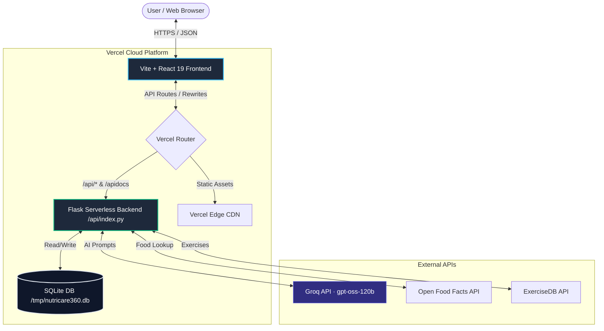
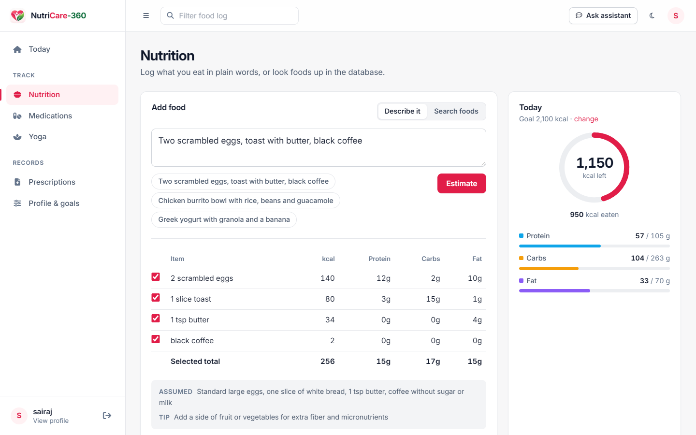
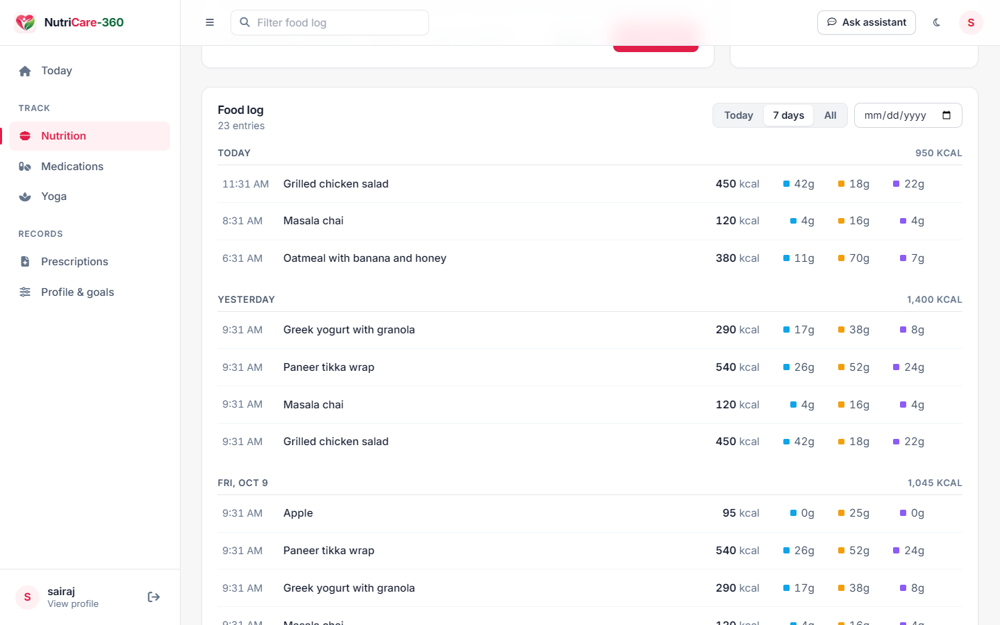
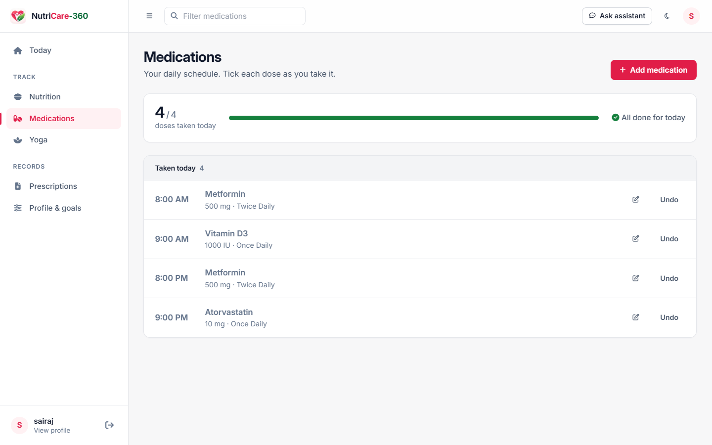
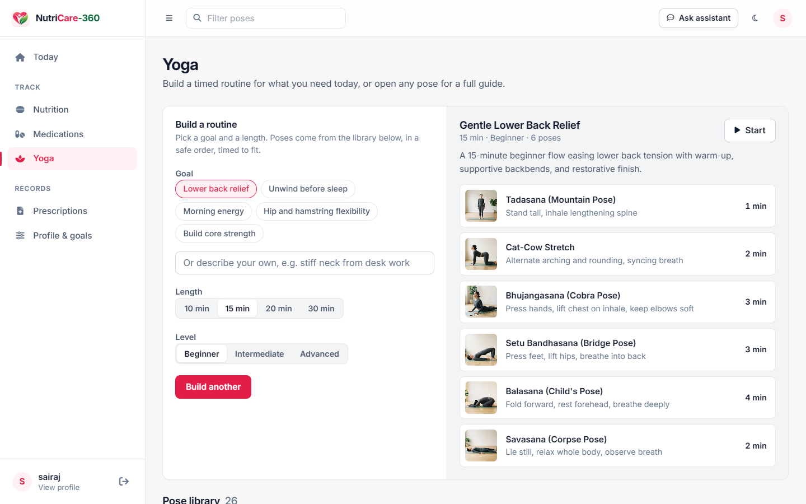
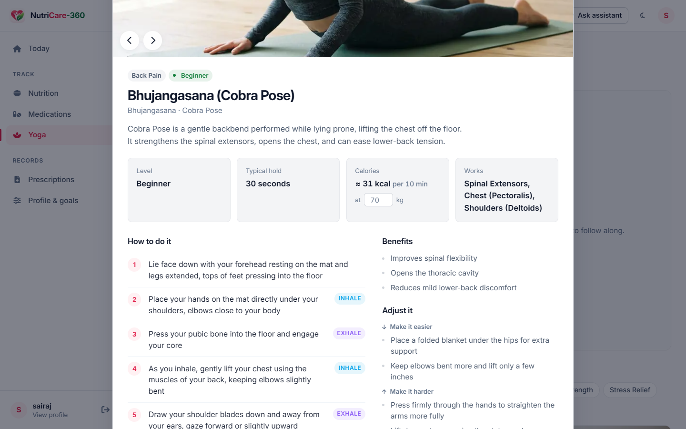
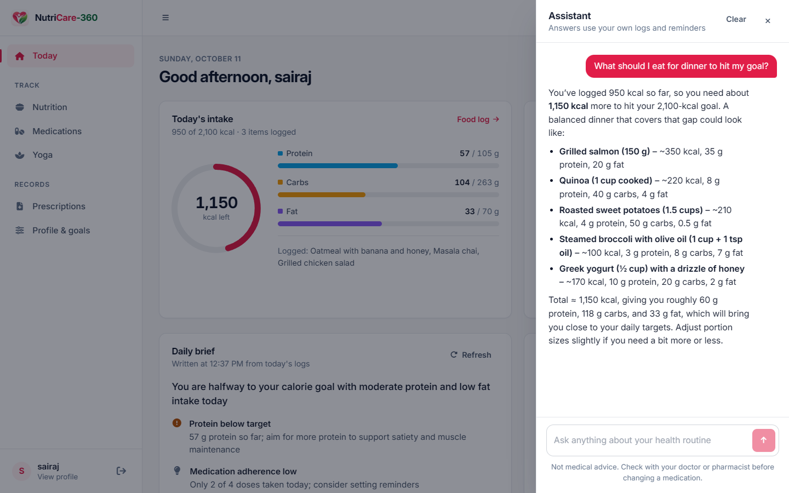
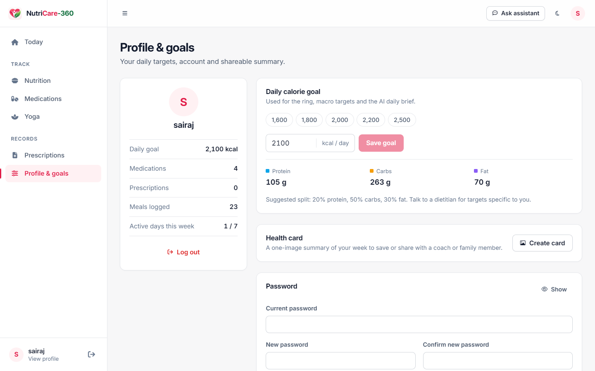

# Case Study: NutriCare-360


> **🔗 Quick Links**
> * 🚀 **[Live Demo](https://nutri-care-360.vercel.app/)**
> * 📖 **[Interactive API Docs (Swagger)](https://nutri-care-360.vercel.app/apidocs)**
> * 💻 **[Source Code & README](../README.md)**

---

## 1. Executive Summary

**NutriCare-360** is a comprehensive, full-stack personal health and wellness ecosystem. It consolidates historically fragmented tasks—such as tracking daily nutrition, managing medicine schedules, storing prescription files, and learning fitness/yoga routines—into a single, high-fidelity dashboard. 

An AI layer on Groq (`openai/gpt-oss-120b` by default) turns plain-English meals into itemized macros, writes a daily brief from the user's own logs, answers questions in an assistant drawer, builds timed yoga routines, and writes reference guides for every pose. Every AI response is validated before it reaches the UI, and the expensive ones are cached. The app deploys to Vercel as a static frontend plus one Python serverless function.

---

## 2. System Architecture

The application is built using a modern decoupled architecture: a **Vite + React 19** frontend, and a **Python Flask** serverless backend. Data persistence is managed via an optimized **SQLite** database, dynamically configured for serverless runtime restrictions.



### Key Architectural Layers:
* **Frontend:** React 19 with route-level code splitting, contexts for global state (Auth, Theme, Flash, Assistant), and a hand-written design system on CSS custom properties (light and dark themes, rem-based scale). Charts are dependency-free SVG.
* **Serverless Backend:** Flask routes handled as Vercel serverless functions, translating requests and interfacing with third-party APIs.
* **Database Management:** SQLite used directly. To satisfy Vercel's ephemeral and read-only container structure, the database is dynamically initialized in `/tmp/` on container cold starts, with key configuration schemas bootstrapped programmatically.

---

## 3. Core Features & Interface Showcase

### 📊 Today Dashboard
One screen for the day: a calorie ring with protein, carbs and fat against targets derived from the user's goal, a medication checklist that can be ticked off in place, a 7-day calorie chart against the goal, and an **AI daily brief** — three observations written from the day's logs plus a next-meal idea that fits the calories left. The brief is cached per user per day and refreshed on demand.


---

### 🪄 AI Meal Analyzer
Users describe a meal in plain English. The model splits it into separate items with calories, protein, carbs, fat and fiber, states the portion sizes it assumed, and suggests one improvement. Users untick anything they didn't eat and log the rest in one click. A database search (Open Food Facts) remains for exact labels.




---

### ⏰ Medications
Medications with dose, time and frequency become a daily schedule, sorted by time and grouped into "still to take" and "taken today", with an adherence bar.



---

### 🧘 Yoga: Routine Builder and Pose Guides
An **AI routine builder** sequences poses from the library for a goal (for example lower back relief) and a length, in a safe warm-up → build → rest order, with a step-by-step timer. Every pose opens a **full guide**: steps tagged with inhale or exhale, muscles worked, a MET-based calorie estimate that uses the user's weight, common mistakes with fixes, easier and harder variations, props, and a "skip or modify if" safety box.




---

### 💬 Assistant
A chat drawer available on every screen. Answers use the user's own logs and reminders, stay short, and follow fixed safety rules: no diagnosis, no medication or dose changes, and urgent symptoms are directed to emergency services.



---

### ⚙️ Customizable Profiles & Health Cards
Users set their daily calorie goal (with the protein, carbs and fat targets it implies), change their password, and export a **Health Card** — a canvas-rendered PNG summary of the week with the NutriCare-360 logo, to share with a coach, dietitian or family member.



---

## 4. Technical Challenges & Engineering Solutions

### Challenge A: SQLite Write Constraints in Serverless Containers
**The Problem:** Vercel functions run in read-only sandboxes. Placing the SQLite database inside the deployed project directory caused `sqlite3.ReadOnlyError: attempt to write a readonly database` when users tried to register or save logs.
**The Solution:** Implemented dynamic environment checks. If running in a Vercel production container, the app mounts the database path (`DB_PATH`) to the `/tmp/` directory (the only writable directory in AWS Lambda/Vercel serverless containers).
```python
if os.environ.get('VERCEL') == '1' or os.environ.get('VERCEL_ENV'):
    VOLUME_MOUNT = '/tmp'
else:
    VOLUME_MOUNT = BASE_DIR
DB_PATH = os.path.join(VOLUME_MOUNT, 'nutricare360.db')
```

### Challenge B: Initializing Database Schema without Terminal Access
**The Problem:** Because serverless containers boot up on-demand (cold starts), the database in `/tmp/` is initially empty, causing query crashes because tables like `users` or `reminders` do not exist.
**The Solution:** Moved the database initialization logic (`init_db()`) to the module level in the Flask entrypoint. This guarantees that every cold start immediately bootstraps the database schema in `/tmp/` before processing any incoming HTTP requests, eliminating database access failures.

### Challenge C: Robust Third-Party API Fallbacks
**The Problem:** Network instability or rate-limiting of free API tiers (like ExerciseDB on RapidAPI) can break core features like the Yoga and Fitness library.
**The Solution:** Implemented defensive code patterns. The API layer wraps external requests in try-except blocks and automatically falls back to curated static JSON assets stored in `api/static/data/` if external APIs are unconfigured or fail.

### Challenge D: A Deprecated Model Silently Broke the AI Feature
**The Problem:** The original meal analyzer called `llama-3.3-70b-versatile`. Groq retired that model, so every request returned `404 model_not_found` and the feature failed for every user, with no visible cause in the UI.
**The Solution:** All AI calls now go through a single helper. The model is configurable (`GROQ_MODEL`), upstream errors are logged server-side, rate limits surface as `429` with a clear message, and Groq's occasional strict-JSON rejections are retried once without strict mode, then parsed defensively. The frontend asks `/api/ai/status` and shows a "not configured" state instead of failing.

### Challenge E: Trusting AI With Health Content
**The Problem:** AI output is shown as guidance about food, medication and exercise, so a malformed or unsafe answer is worse than no answer.
**The Solution:** Every AI response is validated into a fixed shape before it reaches the UI: numbers are clamped (a pose's MET value must fall in a realistic range), lists are trimmed, and references to library items (routine steps, "pairs well with" poses) must match real entries or are dropped. Pose guides are generated once into a reviewed file in the repo — the first review pass caught and fixed unsafe suggestions such as kicking up into a headstand — and the UI labels which guides have been reviewed.

### Challenge F: Rich Photography Without a Slow App
**The Problem:** 30 generated photos (yoga poses, feature images, empty states) totalled 39 MB as PNG; the yoga library alone would have downloaded about 33 MB.
**The Solution:** A build script turns the originals into WebP at two or three widths each (1.1 MB in total). Images use `srcset` and `sizes` so a 52 px thumbnail fetches a 3 KB file, lazy-load below the fold, reserve their space to avoid layout shift, and fade in once decoded. Combined with route-level code splitting and long-lived cache headers, the whole 26-pose yoga library now loads about 207 KB of images.

---

## 5. Security & Development Experience (DX)

* **Authentication:** JWT access and refresh tokens; an Axios interceptor refreshes expired access tokens silently and logs the user out if the refresh fails. Passwords are hashed with Werkzeug's scrypt.
* **Accessibility:** Text meets WCAG AA contrast in both themes, the chart palette was checked for colour-blind separation, every chart has a screen-reader table, and modals, menus and the assistant are keyboard-operable.
* **Interactive API Playground:** Integrated **Flasgger (Swagger OpenAPI 3.0)** directly inside the Flask server. Developers can explore the backend endpoints, parameter schemas, and test responses interactively at `/apidocs`.

---

<!-- Mermaid JS support for live docs rendering -->
<script type="module">
  import mermaid from 'https://cdn.jsdelivr.net/npm/mermaid@10/dist/mermaid.esm.min.mjs';
  mermaid.initialize({ startOnLoad: false });
  
  const convertBlocks = async () => {
    // Find all blocks representing mermaid diagrams
    const blocks = document.querySelectorAll(
      'pre code.language-mermaid, pre.language-mermaid, div.language-mermaid pre, code.language-mermaid'
    );
    
    for (const block of blocks) {
      const code = block.textContent.trim();
      const container = block.closest('.language-mermaid') || block.closest('pre') || block;
      
      const newDiv = document.createElement('div');
      newDiv.className = 'mermaid';
      newDiv.textContent = code;
      
      container.parentNode.replaceChild(newDiv, container);
    }
    
    await mermaid.run();
  };

  if (document.readyState === 'loading') {
    document.addEventListener('DOMContentLoaded', convertBlocks);
  } else {
    convertBlocks();
  }
</script>

